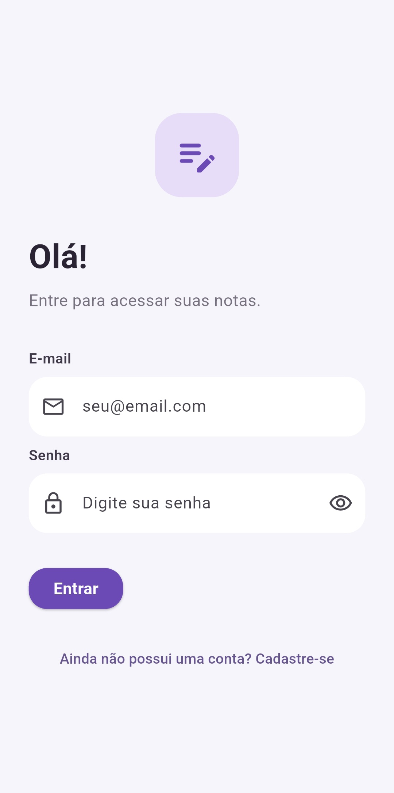
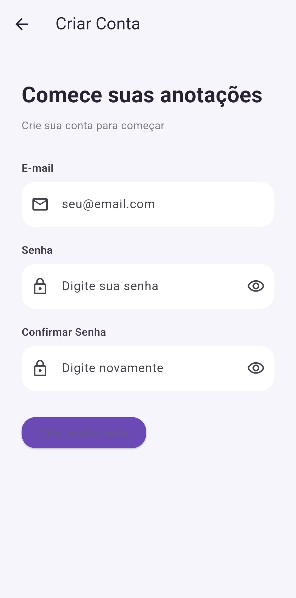
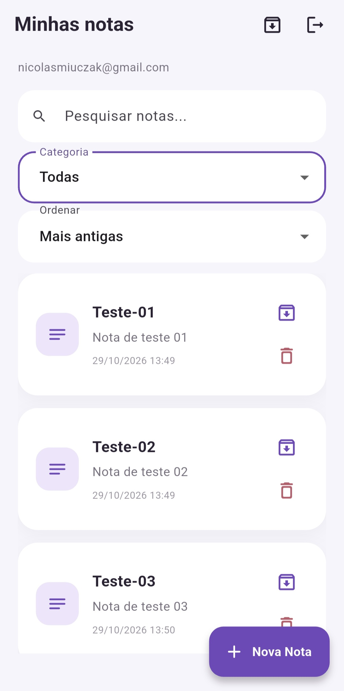
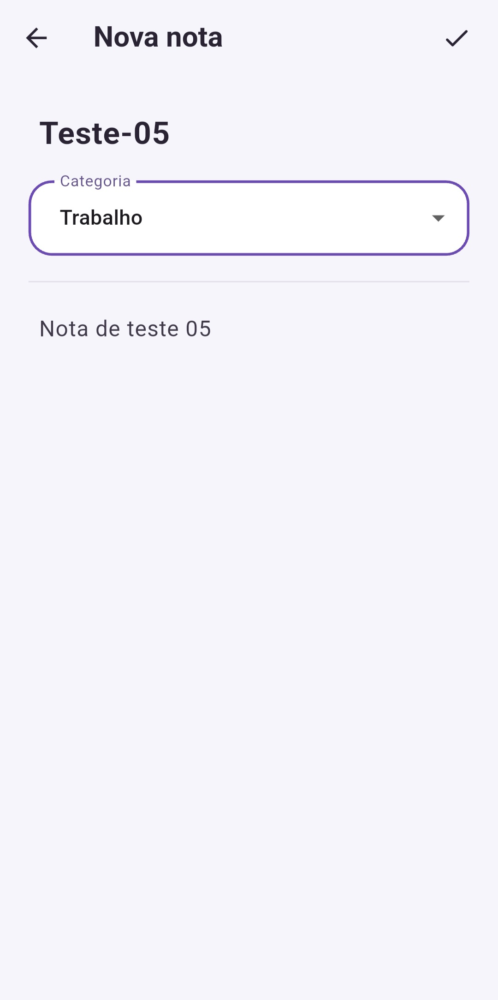
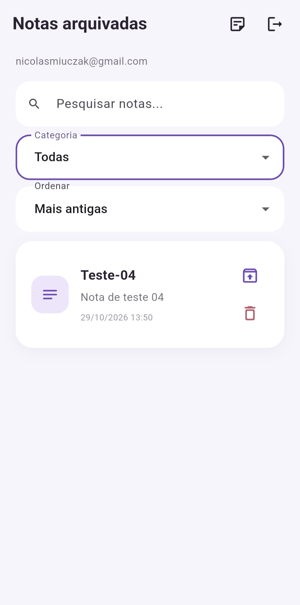
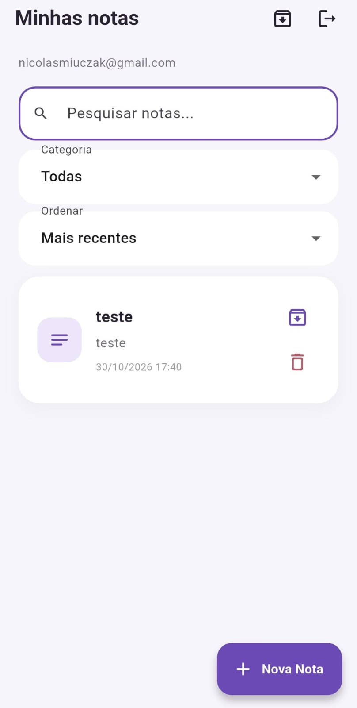
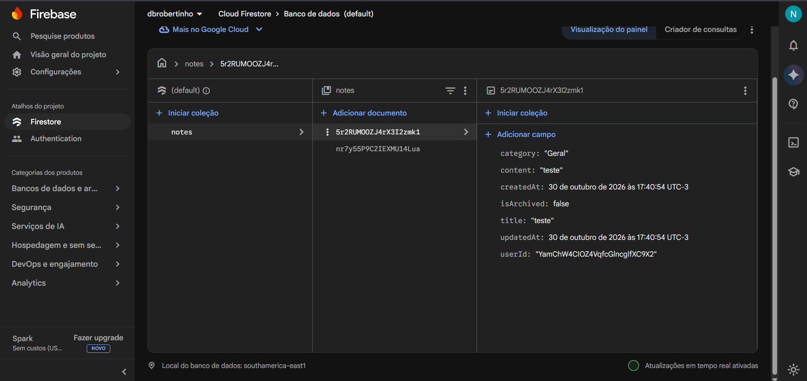

# Bloco de Notas

Aplicativo Flutter para criar e organizar notas pessoais. As notas são mantidas localmente em SQLite e sincronizadas com o Cloud Firestore quando a conexão está disponível.

## Funcionalidades

- **Autenticação:** cadastro e login com e-mail e senha usando Firebase Authentication.
- **CRUD de notas:** criar, consultar, editar e excluir notas.
- **Categorias fixas:** atribuir à nota Geral, Pessoal, Trabalho ou Estudos.
- **Pesquisa:** buscar notas por título ou conteúdo.
- **Filtro por categoria:** mostrar uma categoria específica ou todas.
- **Ordenação:** por criação mais recente ou mais antiga, e por atualização mais recente ou mais antiga.
- **Arquivamento:** arquivar notas sem excluí-las, consultar arquivadas e desarquivá-las.
- **Uso offline:** acessar e alterar notas salvas no SQLite; operações pendentes são tentadas novamente durante a sincronização.

## Implementação da atividade

- **Autenticação e vínculo das notas:** `lib/services/auth_service.dart` usa Firebase Authentication para cadastro, login e logout. `lib/pages/login_page.dart` e `lib/pages/register_page.dart` apresentam esses fluxos. Cada nota recebe o UID do usuário autenticado.
- **Armazenamento local e na nuvem:** `lib/database/database_helper.dart` mantém o SQLite, implementa as operações de notas e sincroniza documentos na coleção `notes` do Cloud Firestore. A nota é gravada localmente primeiro; quando o envio falha, fica marcada para nova tentativa.
- **Modelo e dados sincronizados:** `lib/models/note.dart` define os campos da nota e converte os dados para o formato usado pelo SQLite. Os documentos remotos incluem título, conteúdo, categoria, estado de arquivamento, datas e UID do proprietário.
- **Criação e edição:** `lib/pages/note_form_page.dart` coleta título, conteúdo e uma categoria fixa. Ao editar, preserva o identificador do documento Firestore para atualizar a nota remota existente.
- **Pesquisa, filtros e ordenação:** `lib/pages/notes_page.dart` pesquisa por título ou conteúdo, filtra por categoria e ordena por criação ou atualização. A tela carrega primeiro as notas locais e depois inicia a sincronização.
- **Funcionalidade adicional — arquivamento:** `lib/pages/notes_page.dart` e `lib/widgets/note_card.dart` permitem arquivar, consultar e desarquivar notas. O estado de arquivamento também é sincronizado com o Firestore.
- **Inicialização e interface:** `lib/main.dart` inicializa o Firebase e define o tema e a tela inicial do aplicativo.
- **Evidências:** `docs/images/` contém capturas das telas do app; `NotaTesteApp.jpeg` e `NotaTesteFirebase.png` mostram uma nota de teste no aplicativo e o documento correspondente na nuvem.

## Tecnologias

- Flutter e Dart
- Firebase Core
- Firebase Authentication
- Cloud Firestore
- SQLite com `sqflite`
- `path`, para compor o caminho do banco SQLite

As dependências estão listadas em [`pubspec.yaml`](pubspec.yaml).

## Configuração e execução

### Pré-requisitos

- Flutter SDK compatível com o SDK Dart declarado em `pubspec.yaml` (`^3.12.2`).
- Um projeto Firebase com Authentication (provedor E-mail/senha) e Cloud Firestore habilitados.
- Configuração Firebase para cada plataforma em que o app será executado.

### Passos

1. Clone o repositório e entre na pasta do projeto:

   ```bash
   git clone <URL_DO_REPOSITORIO>
   cd bloco_de_nota_turma_A
   ```

2. Instale as dependências:

   ```bash
   flutter pub get
   ```

3. Confira se `lib/firebase_options.dart`, `firebase.json` e a configuração Android correspondem ao seu projeto Firebase. Para gerar ou atualizar a configuração multiplataforma, use o FlutterFire CLI:

   ```bash
   dart pub global activate flutterfire_cli
   flutterfire configure
   ```

   No Firebase Console, habilite E-mail/senha em Authentication e crie ou habilite o banco Firestore.

4. Execute em um dispositivo ou emulador conectado:

   ```bash
   flutter run
   ```

> Não compartilhe credenciais privadas. A autorização dos dados deve ser aplicada pelas regras do Firestore; arquivos de configuração do cliente não substituem essas regras.

## Arquitetura e sincronização

O código está organizado por responsabilidade:

- `lib/models/note.dart`: modelo `Note` e conversão dos dados locais.
- `lib/database/database_helper.dart`: criação e migração SQLite, operações locais e sincronização Firestore.
- `lib/pages/`: telas de login, cadastro, lista e formulário de notas.
- `lib/widgets/note_card.dart`: cartão da nota e ações de arquivamento e exclusão.
- `lib/services/auth_service.dart`: operações de autenticação.
- `lib/main.dart`: inicialização do Firebase e configuração do app.

### Padrões e organização

- **Acesso a dados (DAO):** `DatabaseHelper` concentra as operações de leitura e escrita do SQLite e a sincronização com o Firestore. As telas usam esses métodos sem executar comandos SQL diretamente.
- **Singleton:** `DatabaseHelper.instance` fornece uma instância compartilhada do acesso a dados e mantém uma única conexão SQLite durante o uso do app.
- **Modelo de dados:** `Note` representa uma nota e centraliza a conversão entre objeto Dart e mapa usado pelo SQLite. A conversão dos documentos do Firestore fica junto da sincronização em `DatabaseHelper`.
- **Separação por responsabilidade:** as páginas cuidam da interface, `AuthService` concentra login e cadastro, `Note` representa os dados e `DatabaseHelper` cuida da persistência.

As categorias são uma lista fixa definida no formulário de notas; não há criação de categorias personalizadas.

### Estratégia offline-first

1. Criar e editar grava primeiro no SQLite e, em seguida, tenta enviar a nota ao Firestore.
2. Notas não sincronizadas ficam marcadas como pendentes. Exclusões também ficam registradas localmente para nova tentativa.
3. Ao abrir a lista, o app mostra primeiro os dados locais e executa `syncNotes()`.
4. A sincronização busca documentos com `userId` igual ao UID autenticado. Notas remotas novas são inseridas localmente; conflitos são reconciliados com base no `updatedAt`.
5. Falhas no Firestore são tratadas para que o uso local continue pelo SQLite.

Os documentos na coleção `notes` contêm `title`, `content`, `category`, `isArchived`, `createdAt`, `updatedAt` e `userId`. As datas são timestamps do Firestore. O ID do documento é guardado localmente para relacionar os registros.

## Segurança do Firebase

As regras abaixo correspondem às regras publicadas no Firebase Console. Elas exigem autenticação, permitem criar notas somente com o UID do usuário autenticado e limitam leitura, edição e exclusão ao proprietário do documento. Na criação, a regra verifica `request.resource.data`, pois o documento ainda não existe; nas demais operações, verifica `resource.data`, que representa o documento existente.

```javascript
rules_version = '2';
service cloud.firestore {
  match /databases/{database}/documents {
    match /notes/{noteId} {
      allow create: if request.auth != null
        && request.resource.data.userId == request.auth.uid;

      allow read, delete: if request.auth != null
        && resource.data.userId == request.auth.uid;

      allow update: if request.auth != null
        && resource.data.userId == request.auth.uid
        && request.resource.data.userId == request.auth.uid;
    }
  }
}
```

Para aplicar as regras em outro projeto, abra **Firestore Database → Regras** no Firebase Console, cole o conteúdo acima e publique. As regras são aplicadas no servidor; as verificações do app cliente não substituem essa proteção.

### Roteiro de testes manuais

Os passos abaixo são um roteiro para validar o aplicativo; registre os resultados depois de executá-los. Use uma conta e notas de teste sem dados pessoais.

1. **Criar e consultar:** entre com uma conta, crie uma nota com título, conteúdo e categoria. Confirme que ela aparece na lista, continua disponível após fechar e reabrir o app (armazenamento local) e surge na coleção `notes` do Firestore, com `userId` igual ao UID da conta.
2. **Editar:** altere título ou conteúdo e salve. Confirme que os dados mudaram no app e no mesmo documento do Firestore, sem aparecer um segundo documento para a nota.
3. **Pesquisar e filtrar:** pesquise uma palavra do título e depois uma do conteúdo; selecione a categoria correspondente. Confirme que aparecem as notas esperadas e que limpar a busca restaura a lista filtrada.
4. **Arquivar e recuperar:** arquive uma nota, abra a lista de arquivadas e desarquive-a. Confirme que o estado `isArchived` muda no documento remoto e que a nota retorna à lista ativa.
5. **Excluir:** exclua uma nota e confirme que ela desaparece do app e do Firestore. Se o celular estiver sem conexão, reconecte e abra novamente a lista para a exclusão pendente ser sincronizada.
6. **Sincronizar após novo login/dispositivo:** crie notas conectadas, saia da conta e entre novamente. Para testar outra instalação, instale o app em outro dispositivo ou emulador, entre com a mesma conta e confirme que as notas da nuvem aparecem.
7. **Uso offline:** ative o modo avião, crie ou edite uma nota e confirme que ela continua visível no app. Desative o modo avião, abra novamente a lista e confira a sincronização no Firestore.
8. **Isolamento entre usuários:** entre com uma segunda conta e confirme que ela não vê as notas da primeira. No Firebase Console, use o simulador de regras, se disponível, para verificar que a segunda conta não consegue ler, atualizar ou excluir o documento da primeira.

O teste automatizado em `test/widget_test.dart` verifica a conversão do modelo `Note` entre objeto e mapa. Ele não substitui os testes manuais de autenticação, banco local, sincronização e regras acima. As regras são aplicadas no servidor; revise-as sempre que o esquema dos documentos mudar.

## Capturas de tela

As capturas abaixo estão na pasta `docs/images/`. Para adicionar outras, use uma tag Markdown como esta:

```markdown

```

### Login



### Cadastro



### Lista, pesquisa e filtros



### Criar ou editar nota



### Notas arquivadas



### Evidências de sincronização com o Firebase

As imagens abaixo mostram uma nota de teste no aplicativo e o documento correspondente armazenado na coleção `notes` do Cloud Firestore. O campo `userId` associa o documento ao usuário autenticado.

#### Nota no aplicativo



#### Nota armazenada no Cloud Firestore


